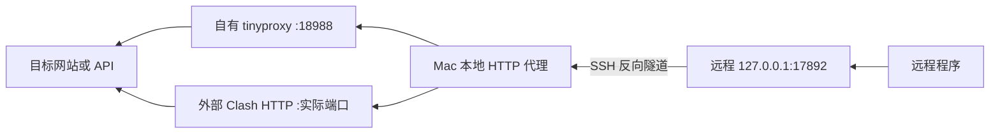
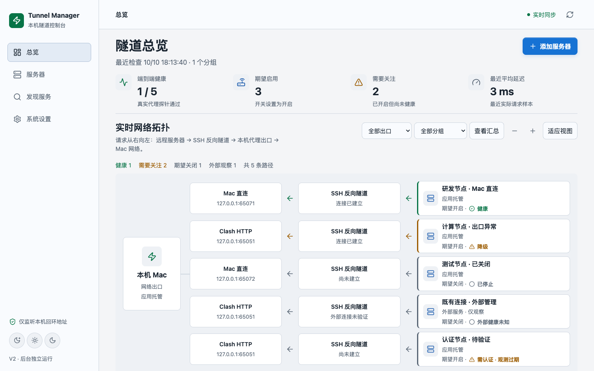
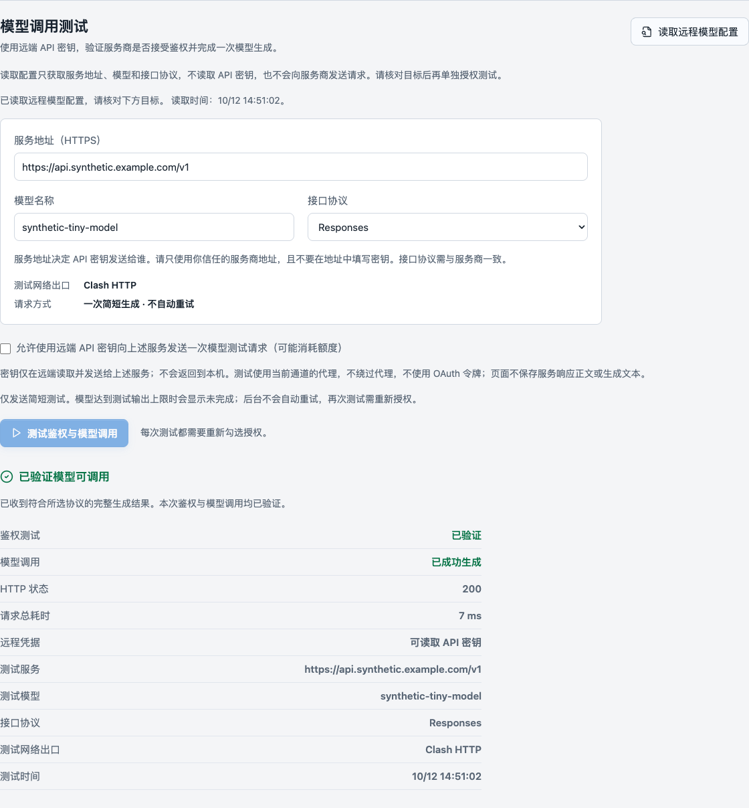

# Tunnel Manager

**让远程 Linux 服务器通过你的 Mac 网络或本地 HTTP 代理访问互联网。**

Tunnel Manager 是面向 macOS Apple Silicon 的多服务器 SSH 反向隧道管理应用。Swift 原生启动器负责启动独立后台，React 中文控制台负责配置、操作和监控。完成本机构建后，可直接双击 `Tunnel Manager.app`，日常使用无需终端，也无需系统 Python 或 Node.js。

> 当前为 **V2.0 本机 ad-hoc 测试版**。仓库提供源码和本机构建流程，尚不是可复制到任意 Mac 的签名公证发行包。源码发布不代表所有系统生命周期、真实服务器和正式发行条件均已验收。

## 目录

- [工作原理与三个端口](#工作原理与三个端口)
- [功能与适用范围](#功能与适用范围)
- [环境要求](#环境要求)
- [从源码构建 macOS App](#从源码构建-macos-app)
- [第一次使用](#第一次使用)
- [让远程程序使用代理](#让远程程序使用代理)
- [Codex 凭据与模型调用测试](#codex-凭据与模型调用测试)
- [源码开发与调试](#源码开发与调试)
- [自动化验证](#自动化验证)
- [架构与项目结构](#架构与项目结构)
- [数据安全与生命周期](#数据安全与生命周期)
- [常见问题](#常见问题)
- [贡献与许可](#贡献与许可)

## 工作原理与三个端口

SSH 连接由 **Mac 主动发起**，代理请求则由远程程序沿反向转发返回 Mac：



| 表单字段 | 示例 | 位于哪里 | 含义 |
| --- | --- | --- | --- |
| SSH 主机、端口 | `ssh.example.com:22` | 远程 SSH 入口 | Mac 连接此入口建立加密通道；云平台可能提供非 22 端口 |
| 远程代理端口 | `17892` | 远程服务器 | 远程程序使用 `http://127.0.0.1:17892` 作为 HTTP 代理 |
| 本地监听端口 | `18988` | Mac | Mac Direct 的自有 tinyproxy 入口；Clash 模式填写其实际 HTTP/mixed 端口 |

转发关系为：`远程 127.0.0.1:17892 → SSH 隧道 → Mac 127.0.0.1:18988`。

不同服务器可使用相同的远程 `17892` 和 SSH `22`；同一服务器上的多个程序也可共用已有代理入口。但同一服务器不能让两条独立隧道同时绑定 `127.0.0.1:17892`，第二条应选如 `17893`。换 SSH 用户、别名或显示名称不能消除实际监听冲突。多台服务器可以共享 Mac 的同一个自有 tinyproxy `18988`，App 会复用该服务。

## 功能与适用范围

| 功能 | 当前行为 |
| --- | --- |
| 多服务器管理 | 添加、编辑、删除、分组、搜索、状态筛选和安全 SSH Config 字面字段导入 |
| 三种模式 | Mac 直连、Clash HTTP、已停用；运行中切换需确认并验证结果 |
| 连接控制 | 真实启停、重启、自动重连、认证错误、端口冲突和日志 |
| 实时监控 | 进程、SSH 连接、远端监听、HTTP CONNECT、HTTP 状态、TLS 和请求耗时 |
| 中文控制台 | 动态拓扑、WebSocket 更新、历史曲线、浅色/深色/跟随系统 |
| 故障恢复 | 状态机、失败阈值、超时、指数退避和有限重试预算 |
| 配置与诊断 | 脱敏导出、完整连接信息备份选项、恢复预览和诊断导出 |
| 外部服务发现 | 只读观察；发现和导入不等于接管，不控制未知进程 |
| Codex 检查 | 独立的网络诊断、凭据读取状态和单次授权真实模型请求 |
| macOS 集成 | 原生菜单栏、独立后台、目录选择、显式登录项设置、项目内安装和卸载 |

适用于远程开发机、GPU 实例和 Linux 工作站，不限于特定厂商。远程程序必须支持并显式使用 HTTP 代理；App 不会自动修改远程环境变量或代理所有进程。它不提供整机 VPN、UDP、SOCKS 出口管理，也不把远程网站发布到公网。

Mac 必须开机、联网且能访问服务器 SSH 服务。关闭浏览器不停止后台；睡眠、关机或网络中断会影响通道。`HEALTHY` 需要真实端到端证据，PID、端口监听或历史 HTTP 200 均不足以单独证明当前健康。拓扑动画不代表测得的带宽。

### 界面预览

以下是已有真实隔离测试环境的截图，使用合成服务器与测试服务；不代表用户真实服务器状态或真实 Key 已验证。





## 环境要求

### 构建与开发机器

| 项目 | 要求 |
| --- | --- |
| 系统 | macOS、Apple Silicon `arm64`；编译目标 macOS 13+，旧系统和干净 Mac 仍需分别验收 |
| 项目路径 | 当前用户可写的实际目录，避免符号链接及过长路径，Unix socket 有长度限制 |
| Python | **3.12**，使用 `uv` 按 `uv.lock` 安装到项目 `.venv` |
| Node.js | 建议 Node.js 22；依赖以 `package-lock.json` 和 `npm ci` 为准 |
| Apple 工具链 | Xcode Command Line Tools，提供 Swift、SDK、`codesign`、`iconutil` |
| tinyproxy | 当前打包固定验证 **1.11.3**，预期 Homebrew `/opt/homebrew/opt/tinyproxy` |
| 浏览器 | 日常使用本地浏览器；当前 E2E 配置需要本机 Google Chrome |

Python、Node.js 和 Homebrew 是**构建依赖**。App 包含冻结 Python、Web 静态资源及 tinyproxy，使用系统 `/usr/bin/ssh`。Clash 是可选外部依赖，不随 App 启停。

### 远程服务器

- Mac 能访问 SSH 地址和端口；SSH 服务允许远程 TCP 转发，所选远程监听端口空闲。
- 使用密钥或 SSH Agent 免交互认证。App 使用 `BatchMode`，没有密码或交互式二次认证输入窗口。
- 主机指纹已由用户核验并加入可信 known_hosts；App 保留严格校验。
- Linux 健康检查需要 `ss`（通常来自 iproute2）和 `curl`，缺失应报告检查不可用。
- Codex 凭据与模型检查额外需要远端 `/usr/bin/python3`。非交互 SSH 的 `CODEX_HOME`/`HOME` 可能与编辑器不同。

导入只解析允许的 SSH Config 字面字段，不执行 `Match exec`、`ProxyCommand`、`LocalCommand`、`Include`，也不自动继承跳板链。仅通过这些高级指令连接的主机需要另行评估。远程 Windows、路由器和受限 shell 未作兼容承诺。

## 从源码构建 macOS App

仓库不含维护者路径绑定的 App、数据库、个人 SSH 配置或本机审计历史。请在自己的 Mac 构建；App 绑定构建时项目路径和磁盘卷 UUID，不能作为跨机器安装包直接复制。

### 1. 获取代码并安装项目依赖

先自行准备上述工具链，再执行：

```sh
git clone https://github.com/Monster-MVP/tunnel-manager.git
cd tunnel-manager
mkdir -p var/tmp var/cache/uv var/cache/npm var/cache/pycache var/python
export TMPDIR="$PWD/var/tmp"
export UV_CACHE_DIR="$PWD/var/cache/uv"
export UV_PYTHON_INSTALL_DIR="$PWD/var/python"
export npm_config_cache="$PWD/var/cache/npm"
export PYTHONPYCACHEPREFIX="$PWD/var/cache/pycache"

uv sync --frozen --python 3.12
npm ci
npm run build
```

构建不会替你安装或启停 Homebrew 服务、修改系统代理或开放防火墙。tinyproxy 已安装其他版本时，不要直接覆盖正在使用的版本来满足本仓库。

### 2. 准备匹配的 tinyproxy 源码

打包保留 tinyproxy 1.11.3 匹配源码并校验 SHA-256。已有相同文件时可复用：

```sh
mkdir -p var/build
curl --fail --location --proto '=https' --tlsv1.2 \
  https://github.com/tinyproxy/tinyproxy/releases/download/1.11.3/tinyproxy-1.11.3.tar.xz \
  --output var/build/tinyproxy-1.11.3.tar.xz
printf '%s  %s\n' \
  f05644fdf1211ba13754a354bebed909b5b39371b12cce8563c46929a75bedf6 \
  var/build/tinyproxy-1.11.3.tar.xz | shasum -a 256 -c -
```

版本、内容或许可文件不匹配应拒绝构建，不跳过校验。安装工具和下载源码不等于启动 tinyproxy 服务。

### 3. 构建、校验、打开

**不要重建运行中的默认 App。** 如本项目 App 已在使用，先由用户明确停止其后台并确认影响，不使用 `pkill ssh` 或结束外部代理腾出端口。

```sh
/bin/sh packaging/macos/build-app.sh
/bin/sh tests/macos/test_packaging.sh
open "var/dist/Tunnel Manager.app"
```

输出为 `var/dist/Tunnel Manager.app`。首次运行可能出现“授权访问 Tunnel Manager 项目目录”，请亲自选择当前 clone 的项目根。取消或选择其他目录不启动后台；不要修改 TCC、关闭 Gatekeeper 或禁用 SSH 主机指纹验证。

当前是本机 ad-hoc 签名，没有 Developer ID 公证。标准应用目录安装、跨 Mac 数据迁移、干净机器和旧系统兼容性需后续发行验收。

## 第一次使用

1. 双击 App，等待菜单栏和本地控制台打开。
2. “服务器”→“添加服务器”，填写名称、SSH 主机、用户、端口及必要的密钥路径引用。
3. 选择出口：Mac 直连通常用本地 `18988`；Clash HTTP 必须填写实际 HTTP/mixed 端口，不能填写 SOCKS-only 或控制器 API 端口。
4. 选择空闲远程高位端口，例如 `17892`。同一远程主机上的第二条独立通道用其他端口。
5. 保存后默认关闭，需要明确测试或启动才连接。
6. 点击“启动隧道”，检查真实 SSH、远端监听和端到端结果，再配置远程程序使用代理。

| 模式 | 行为 | 注意 |
| --- | --- | --- |
| Mac 直连 | App 创建并共享自有 tinyproxy，使用 Mac 网络 | 仅不使用 Clash HTTP 入口；系统 TUN/透明代理仍可能影响出口 |
| Clash HTTP | 使用已经运行的 Mac loopback HTTP 代理 | 不安装、启动、停止或修改 Clash |
| 已停用 | 停止该配置的自有反向隧道 | 不影响其他普通 SSH 登录 |

“发现服务”导入的 **外部服务·仅观察** 记录不可直接启停。建立独立通道应使用添加向导并避开已有端口。当前保留 `17890`、`17891` 等历史生产端口保护，不通过新配置接管原服务。

关闭浏览器或“退出菜单栏（保留后台）”不会停止通道。登录恢复需要用户启用本应用登录项、macOS 允许、项目卷已挂载且认证可用。实际重启、登录及休眠等场景仍应在自己的环境专项验收。

## 让远程程序使用代理

以下示例应在**远程服务器**运行，不是在 Mac。假设远程端口为 `17892`：

```sh
curl --proxy http://127.0.0.1:17892 https://example.com/
```

也可只为单次命令设置变量，不写入 shell 启动文件或全局环境：

```sh
HTTP_PROXY=http://127.0.0.1:17892 \
HTTPS_PROXY=http://127.0.0.1:17892 \
http_proxy=http://127.0.0.1:17892 \
https_proxy=http://127.0.0.1:17892 \
curl https://example.com/
```

其他程序是否使用这些变量取决于自身实现及 `NO_PROXY` 等设置。HTTPS 目标通过 HTTP CONNECT，所以代理地址使用 `http://` 是正常的。App 不修改远程 shell 配置；探测成功不能证明服务器所有程序均使用该代理。

## Codex 凭据与模型调用测试

| 检查 | 能证明 | 不能证明 |
| --- | --- | --- |
| 网络诊断 | 一次 SSH/监听/HTTP/TLS 代理请求结果 | Key 有效或模型生成成功 |
| 远程登录凭据 | 当前 SSH 会话可见的 Codex `auth.json` 可否安全读取、是否含 API Key | 服务商鉴权和模型成功 |
| 模型调用测试 | 用户审查的目标收到一次真实请求，并返回完整非空生成 | 其他模型、后续额度、业务质量和长期稳定性 |

使用已建立的**自有托管连接**，在详情“模型调用测试”中：

1. 点击“读取远程模型配置”，或手动填写 HTTPS 基础地址、模型和协议。
2. 核对接收 Key 的目标域名，以及 Responses / Chat Completions 协议。
3. 勾选单次授权，确认可能消耗额度，再点击“测试鉴权与模型调用”。
4. 仅“已验证模型可调用”表示本次收到完整非空生成；再次测试需重新授权并等待 30 秒冷却。

配置预览不读 Key、不请求服务商。Key 只在远端短命进程解析，通过当前反向代理的 Authorization 请求头发送给核对的目标；Mac 仅收到固定状态、HTTP 码和耗时，不接收密钥、生成文本或服务商正文。

当前支持公网 HTTPS/443 的固定 Responses/Chat API Key 请求，不使用 OAuth，不支持内网 API/自签证书，不跟随重定向、不跳过 TLS、不直连回退、不自动重试计费调用。固定提示为 `Reply with OK only.`，最多输出 128 token。只有推理或达到上限可能导致未完成，不能据此认定 Key 无效。

401、403、429、模型不可用、TLS/网络/超时、HTML 200、空和未完成输出分别报告。旧成功带历史标记，不冒充本次成功。凭据文件需满足所有者、私有权限、普通文件和路径校验；App 不自动修改权限，不扫描整机凭据。非交互 SSH 的 Codex 目录可能与编辑器不同。

旧“Codex 网络诊断”仅允许内置白名单地址，并不是任意 API 测试器；其他模型服务使用上述独立流程。

## 源码开发与调试

先安装依赖并 `npm run build`。开发后端使用独立目录，避免与 App 数据混用：

```sh
.venv/bin/python scripts/serve.py \
  --data-dir "$PWD/var/data/dev" \
  --runtime-dir "$PWD/.run/dev" \
  --web-dir "$PWD/var/build/web" \
  --port 0 \
  --tinyproxy-executable /opt/homebrew/opt/tinyproxy/bin/tinyproxy
```

保持该终端运行；另开终端进入同一项目根：

```sh
.venv/bin/python scripts/open_dev_console.py
```

控制台使用动态 loopback 端口。打开脚本通过私有 Unix socket 获取一次性票据并打开浏览器，不打印或保存票据。其他独立开发 runtime 可传 `--runtime-dir`；脚本拒绝 App 的 `.run/app`。该模式仅用于开发，最终用户双击 `.app`。

前端迭代：

```sh
npm run typecheck
npm run lint
npm run build
```

修改后重建 Web，刷新开发后端的页面。不要覆盖运行中已签名 App 的资源。

`npm run dev` 仅启动 `127.0.0.1:18400` 的 Vite 静态服务，当前没有 API 代理和完整认证桥接，不能当作可管理隧道的全栈入口。真实 API、静态资源和 WebSocket 使用同源后端。

后端 `/api/v1` 验证会话 Cookie、Origin、CSRF；配置更新校验 revision，连接动作返回 operation ID 后再查询最终结果。WebSocket 使用单次握手票据。API 实现见 `apps/backend/app/api/routes.py`，共享类型见 `shared/types.ts`。不要通过取消认证或监听 `0.0.0.0` 来调试。

## 自动化验证

测试按依赖分层，**干净 clone 未构建 App 时不能无条件执行全量测试并期待通过**。

基础逻辑及隔离 SSH：

```sh
npm run typecheck
npm run lint
.venv/bin/ruff check apps/backend scripts/open_dev_console.py packaging/macos/build_metadata.py
.venv/bin/pytest tests/backend tests/coordinator tests/tunnels \
  tests/macos/test_safe_paths.py tests/macos/test_build_metadata.py -q
```

模型安全与可靠性专项：

```sh
.venv/bin/pytest \
  tests/v2-security/test_codex_model_test_security.py \
  tests/v2-reliability/test_codex_model_test_live.py -q
```

这些测试使用合成凭据、真实 loopback SSH/CONNECT/TLS 夹具，不调用真实付费提供者。工具缺失导致的 skip/不可用应明确记录，不能宣称实测成功。

先构建 App、安装 Google Chrome，再进行冻结包和浏览器验收：

```sh
/bin/sh tests/macos/test_packaging.sh
npm run test:e2e
.venv/bin/pytest
```

冻结测试读取 `var/dist/Tunnel Manager.app`，部分 Python 候选测试支持 `TUNNEL_MANAGER_TEST_APP` 选择项目内候选。浏览器夹具使用独立后端和数据。全量还包括签名、系统工具和安装生命周期测试，请先理解前置条件。

输出留在 `var/reports`、`var/tmp` 和 `.run`，不提交 Git。测试数量、截图或模拟响应不能代替真实用户链路、独立视觉和系统生命周期验收。

## 架构与项目结构

```text
双击 App → Swift 菜单栏 → 独立 Swift ServiceHost
                                ↓
                        冻结 FastAPI 后端
                       ↙       ↓       ↘
               React 控制台  SQLite   自有 SSH / tinyproxy
```

| 目录 | 技术与职责 |
| --- | --- |
| `apps/web` | React、TypeScript、Vite、Lucide、Recharts；中文 UI 与真实 API |
| `apps/backend` | Python 3.12、FastAPI、SQLite、WebSocket；状态机、探测和重连 |
| `apps/macos` | Swift、AppKit、ServiceManagement；菜单栏、目录授权、后台宿主 |
| `shared` | 跨端 TypeScript 类型 |
| `packaging/macos` | 冻结后端、图标、签名、第三方许可、项目内安装和回滚 |
| `scripts` | 开发启动、控制台打开、隔离验收与检查记录 |
| `tests` | 单元、安全、真实隔离 SSH/TLS、冻结包和浏览器测试 |
| `docs/public` | 公共开发说明和经审查的截图 |
| `var`、`.run` | 本机数据、缓存、构建和私有 IPC，Git 忽略 |

后端拥有自己创建的 SSH/tinyproxy，Swift 宿主持有后端及独立进程组。后端异常恢复可能使自有隧道短暂中断，不能称为连接无损；关闭浏览器与停止后台是不同生命周期。

## 数据安全与生命周期

- App 数据为 `var/data/app`，开发建议 `var/data/dev`；私有 runtime 分别为 `.run/app`、`.run/dev`，短 SSH socket 位于 `.run/s`。
- 构建为 `var/build`，App 为 `var/dist`，安装/回滚为 `var/install`，报告为 `var/reports`。
- 新监听只绑定 loopback，数据和 IPC 使用私有权限，不自动暴露局域网控制入口。
- 私钥仅保存路径引用交给 OpenSSH，不复制到数据库、导出和源码。默认配置导出脱敏；需要可恢复连接信息时明确勾选并安全保管。
- 升级前停止自有后台，保留一致数据库和旧 App；安装/卸载只处理本应用登记资源，不移除原 SSH 配置或外部代理。
- 项目移动会使绑定路径/卷失效，需另行备份、在新位置构建并验证恢复，不能仅复制 App 后删除原数据。
- 登录/重启、休眠/唤醒、拔盘和物理网络切换仍需实机专项验收。

首次源码发布使用独立清理快照，不包含维护者私人 Git 历史、本机审计、真实配置、数据库和机器绑定 App。少量展示截图来自已审查的隔离环境。

## 常见问题

| 现象 | 检查方向 |
| --- | --- |
| 导入后启动不可用 | “外部服务·仅观察”不可控制，请添加独立托管通道 |
| `DEPENDENCY_UNAVAILABLE` | HTTP 代理未监听、误填 SOCKS/控制器端口，或开发后端未指定 tinyproxy |
| `AUTH_REQUIRED` | 检查指纹、known_hosts、用户及密钥/Agent，不关闭安全校验 |
| `PORT_CONFLICT` | 检查实际网络环境已有监听；选空闲端口，不停止未知进程 |
| SSH 正常但代理异常 | 检查出口、远端 `ss`/`curl`、目标和预期 HTTP 状态 |
| 直连仍受代理影响 | 系统 TUN/透明代理仍可能作用于 Mac 出口 |
| Key 不可读取 | 区分缺文件、会话目录差异、权限过宽、符号链接、JSON 和工具问题 |
| HTTP 200 但模型未验证 | 网页、空输出或未完成生成不算成功 |
| 控制台失联 | App 菜单“打开控制台”，开发模式重新运行打开脚本，勿为刷新偷偷重启后台 |
| Unix socket 路径过长 | 初次构建前选择较短、无符号链接的项目目录 |

## 贡献与许可

请阅读 [开发说明](docs/public/development.md) 和仓库 `AGENTS.md`，提交范围明确的变更及验证。不提交 `.venv`、`node_modules`、`var`、`.run`、私钥、API Key、真实服务器配置、数据库、书签或票据链接。

**本项目尚未选择自身的开源许可证**，不要默认具有 MIT、Apache 或 GPL 授权；使用、修改及再分发的授权范围需由所有者明确。第三方组件分别遵守原许可证。打包保留 Python/npm 许可清单及 tinyproxy 的 GPL 许可与匹配源码；源码上传、本机 ad-hoc 构建不等于公开二进制发行的许可、公证审查完成。
